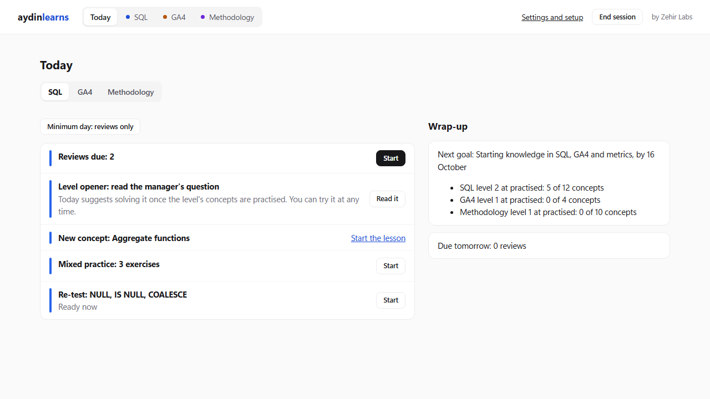
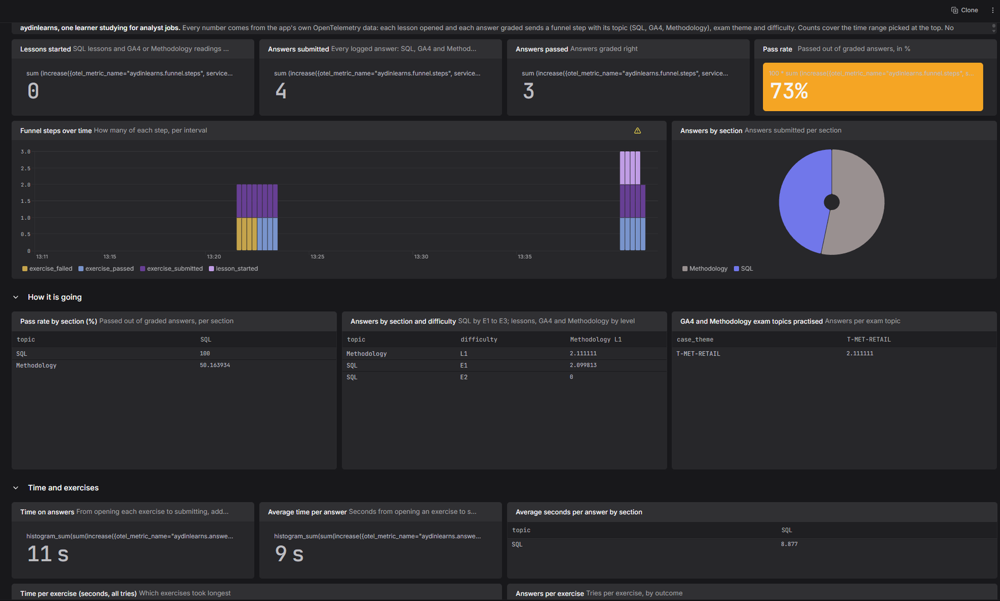
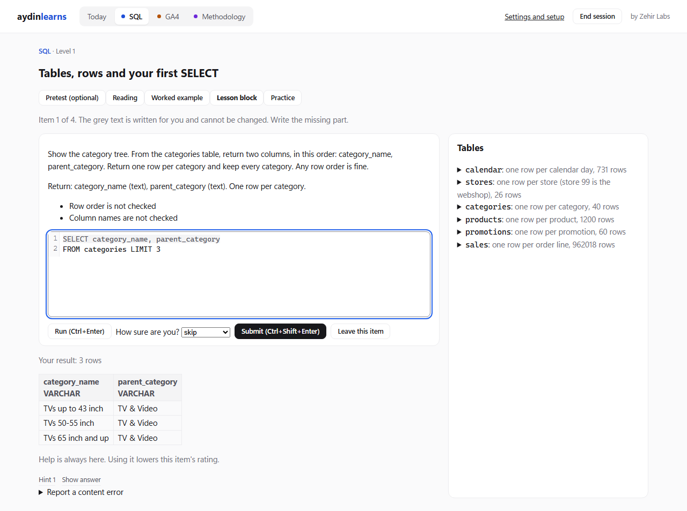
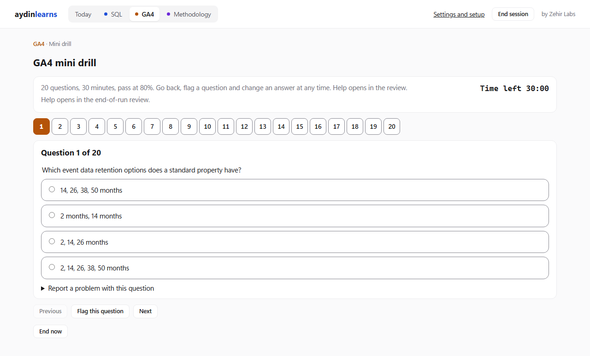

# aydinlearns

A local study app for getting hired as a data, marketing or commercial analyst. It covers the
three things recruiters test: **SQL**, **GA4** (Google Analytics 4) and **analytics methodology**
(metrics, A/B testing, statistics and pricing). Every query the learner writes runs on a real
database and is graded on its result, and the app names the mistake ("you averaged the ratios") instead of only
saying "wrong".



## What can be studied now

| Section | Content |
|---|---|
| SQL | Levels 1 to 5, 32 concepts from the first SELECT to aggregation, CASE, types, dates, joins, CTEs, set operations, subqueries, text, date arithmetic, data cleaning and window functions: lessons with worked examples, 902 exercises (write the query, fix the query, predict the result, choose the query), timed drills and a cumulative drill over levels 1 to 4, raw tables with planted errors to clean, 34 cases in an inbox (an opener for each level, eleven daily cases, five pricing cases, two retail cases, five data-quality tickets, four marketing cases on a second company, Mailvora, and two take-home cases on real data), mistake cards for the mistakes that keep coming back, "other ways to write this" after a pass, a dataset explorer over both companies and the real datasets you prepare, and a portfolio export with flagship drafts on real data |
| GA4 | Complete for the certification: 16 lessons and 123 questions (73 for practice and 20-question mini drills, 50 held out for 25-question half-mocks and 50-question full mocks), a readiness check, and 10 interview labs in Google's GA4 demo account, each re-checked a week later |
| Methodology | 78 concepts, each with a reading: 51 metrics (marketing, retail, pricing and SaaS), 13 on experiments and A/B testing, 9 on statistics and 5 on pricing economics. 478 questions, 93 of them held out for mocks |
| Recruiter mocks | Four timed mocks on questions you have not seen: the screen mock (stage 2's online SQL test), the knowledge mock (stage 3), the case-round mock (stage 4) and the take-home mock (stage 5). The Recruiter mocks screen has one card per recruitment stage, with the readiness board's status, each mock's history and the live reps |

## Real datasets

Two real datasets and one practice set can be added to the explorer and the inbox. None of them is
in this repository: you download them yourself, and the app prepares them on your laptop. Until a
dataset is prepared, its cases show in the inbox with the command that prepares it, and nothing else
changes.

| Dataset | Where to get it | What to keep | Licence |
|---|---|---|---|
| Online Retail II (real data: the invoice lines of a UK online gift shop, December 2009 to December 2011) | The [UCI page](https://archive.ics.uci.edu/dataset/502/online+retail+ii), Download button | `online+retail+ii.zip`, zipped or unzipped | [CC BY 4.0](https://creativecommons.org/licenses/by/4.0/): free to share and adapt, with credit |
| Breakfast at the Frat (nearly real data: dunnhumby's 156 weeks of store sales and promotions in four categories) | dunnhumby's [Source Files page](https://www.dunnhumby.com/source-files/), Breakfast at the Frat button (it may ask for a name and an email) | `dunnhumby_Breakfast-at-the-Frat.zip` | [dunnhumby terms](https://www.dunnhumby.com/terms-and-conditions/): research, personal or non-commercial use only |
| The 8 Week SQL Challenge (fictional data, handmade by its author, Danny Ma) | Each case study page at [8weeksqlchallenge.com](https://8weeksqlchallenge.com) links its schema script on DB Fiddle | The eight scripts as text files named `case-study-1-dannys-diner.sql` to `case-study-8-fresh-segments.sql`, in a folder `8-week-sql-challenge` | No licence stated. The app copies none of the challenge's questions, data or scripts |

Put the files in one folder (your downloads folder is fine), then run:

```
npm run prep:datasets -- --from <that folder>
```

Add `--only <dataset ID>` (`DS-RETAIL-02`, `DS-PRICE-101` or `CH-01`) to prepare one. The prep checks
each file's fingerprint against the registry's (a different file warns and is recorded, and the prep
goes on), reads it into `data/real/`, prints its checks (row counts, what it removed and
why), and then rebuilds the course database. Run it again after updating the app. Each dataset's notes
in the explorer say what the prep changed and what it left as the source has it.

What is never committed: the downloaded files, `data/real/`, the course database, and any question,
row or script of the 8 Week SQL Challenge. The registry (`content/datasets/registry.json`) holds only
names, file names, fingerprints, licences, links and our own manager questions.

## Study tracking with OpenTelemetry

Optional, and off unless you turn it on. The app can send its own OpenTelemetry traces, metrics and logs to
[Dash0](https://www.dash0.com/) or any OTLP backend. Every lesson opened and every exercise answer graded becomes a funnel
step with its section, exam topic and difficulty, and each answer carries the exercise, the time it took, which try
it was, the help used and how sure the learner was. A dashboard then shows the studying as it happens: answers and
pass rate, the funnel over time, pass rate by section and by confidence, time per exercise, and the app's own
response times and errors.



[Telemetry with OpenTelemetry](#telemetry-with-opentelemetry-optional) lists what is sent and how to turn it on.

## Your study journey

The app keeps every visit as one ordered journey (owner decision D77): the screens shown, the exercises sent and
answered, the help used, timed runs, cases, labs, review cards and each concept's state as it changes. It stays on
this computer, and `npm run journey` loads it into DuckDB for analysis in SQL. With telemetry on, the same events also
go to Dash0.

A **visit** starts with its first event and ends after 30 minutes with nothing happening, or when the app stops. No
timer watches the gap: the first event after it writes the end of the visit before it, stamped with that visit's last
activity, and then starts a new visit. A visit is not the app's study session: opening screens never starts a study
session, and the study session's own start and end show in the journey as two events of their own.

One exception: when you come back after 30 minutes away and the first thing the journey records is a screen view or a
page read (a GET), before the app's once-a-minute check has ended the old study session, the new visit opens first, so
that study session's `study_session_ended` and everything its end writes (its `item_closed`, a leech reset's
`review_card_changed`, and the `concept_state_changed` they cause) land in the new visit, at the new visit's time. The logs, the replay and your study history are not
affected.

Each event is one line with its time (`ts`), its visit (`session_id`), its place in the visit (`seq`), its name
(`event`), the app's version (`app_version`) and the line's format (`v`, now 1), plus what the table below lists. The
time is when the app recorded what happened; an event taken from the app's own log carries that record's time. An
event is never stamped before the visit's latest event, nor later than the moment it is written, so a visit ordered by
`ts` and then `seq` reads in the order its events were sent.

| Event | When | What it carries |
|---|---|---|
| `session_started` | A visit starts | `reason`: `app_start` for the first visit since the app started, or `idle` after a gap, with the visit before it (`previous_session_id`) |
| `session_ended` | A visit ends: written by the first event after 30 idle minutes, or when the app stops | `reason`: `idle` (also when the app stops more than 30 minutes after the visit's last event) or `app_stop`; `duration_s` (first event to last) and `event_count` (the events between its start and end). Stamped with the visit's last activity |
| `screen_viewed` | The browser shows a screen, outside setup mode. It is recorded even while the log cannot be written | `screen`, the screen before it in the visit (`from_screen`), and the exercise, concept, case or lab in the address (`subject_id`) |
| `lesson_started` | A SQL lesson, or a GA4 or Methodology reading, opens | `topic`, `case_theme`, `difficulty`, `funnel_step` |
| `item_viewed` | An exercise is sent to the browser. A screen may fetch one twice as it opens, and a drill or a practice run sends all its questions at its start, so this counts sends, not looks | `item_id`, `topic`, `case_theme`, `difficulty`, and for a multiple-choice question (GA4, Methodology, or an SQL predict or choose item), a case checkpoint (CP1, CP2, CP4, CP5) or a screen mock question the `phase` |
| `exercise_submitted` | An answer is checked | `item_id`, `time_spent_s`, `time_target_s`, `try_number`, `hints_used`, `answer_shown`, `confidence`, `mode` and `outcome` (`passed`, `failed` or `not graded`), with `topic`, `case_theme`, `difficulty` and `funnel_step` |
| `exercise_passed`, `exercise_failed` | A graded answer passes or fails | `item_id`, `topic`, `case_theme`, `difficulty`, `funnel_step` |
| `hint_opened`, `answer_shown`, `other_way_opened` | A hint, "Show answer" or "Other ways to write this" opens | `item_id`, `concept_id`, `topic`, `phase`, whether it reviews a mistake card (`review`; a scheduled review shows as `phase` `review`), and a hint's `hint_level` |
| `item_closed` | An exercise is closed: left, finished, or at a session's end | `item_id`, `concept_id`, `topic`, `phase`, `reason`, `graded_attempts`, `passed`, `first_attempt_pass`, `max_hint_level`, `active_s`, `rating` |
| `material_studied` | A reading, worked example or lesson is studied | `concept_id`, `topic`, `kind` |
| `run_started`, `run_finished` | The run screen starts a timed run, or ends it (its end button, or its clock at zero): a GA4 mini drill, half-mock or full mock, a SQL drill, a live rep or a screen mock. A run the app ends by itself (its timer with the screen closed, a study session's end or the app's stop) sends its `run_finished` too, once per run (D81) | `section`, `run_kind`, `block_id`; at the start `questions`, and for SQL `screen_mode` and a level drill's `level`; at the end `score_pct`, a level drill's `level`, and `run_passed` for every run but a live rep, whose pass waits for its "explained aloud" tick after the end (a `case_self_check`), and a case mock (case-round or take-home), whose `run_finished` at its hand-in carries the score of checkpoints 1 to 5 and no result, since its pass waits for its rubric. A knowledge mock names no `section` |
| `case_opened`, `case_self_check`, `case_exported` | The case screen loads a case, a self-check is logged, or the case goes to the portfolio. The case screen loads its case again after each step is saved or answered, so `case_opened` counts loads, not opens; `screen_viewed` with `screen` `case` or `opener` counts opens | `case_id`; a self-check's `kind` and `phase`; an export's `data_source` |
| `lab_opened`, `lab_answered` | A GA4 lab opens, or its answers are checked | `lab_id`; an answer's `kind` (`first` or `recheck`) |
| `review_card_changed` | A review card is paused, resumed, reset or retired | `card_id`, `kind` |
| `concept_state_changed` | A concept's state changes after an answer, a close, a reading or a card change | `concept_id`, `topic`, `state_from`, `state_to` |
| `study_session_started`, `study_session_ended` | The app's study session starts or ends. A session the last run left open, which the app ends as it starts, is not in the journey | The end: `reason` (`explicit` or `idle`) and `active_minutes`. The start carries only the fixed fields |

`concept_id` and its `topic` are there only for a concept the content knows; any other value is left out. The four
learning funnel steps (`lesson_started`, `exercise_submitted`, `exercise_passed`, `exercise_failed`) carry
`funnel_step`, which repeats the event's name.

**Where it is kept.** In `journey/events-YYYY-MM.jsonl`, one file a month, in this folder. Git ignores `journey/`, so it
is never committed. It is on by default, and two lines in `.env` change that:

| Setting | What it does |
|---|---|
| `AYDINLEARNS_JOURNEY=off` | Writes no journey file; `false`, `0` and `no` do the same. With telemetry on, the events still go to Dash0. Any other word leaves the file on, and the app says so when it starts |
| `AYDINLEARNS_JOURNEY_DIR=<folder>` | Keeps the journey in another folder. `npm run journey` reads the same setting. A server started on a temporary logs folder (`AYDINLEARNS_LOGS_DIR`, as the tests do) writes no journey file unless this names a folder too |

A journey folder that cannot be written never stops the app: the event is not kept, the console says so once, and the
next event tries the file again.

**How to analyse it.**

| Command | What it does |
|---|---|
| `npm run journey` | Rebuilds `journey/journey.duckdb` from the files and prints every starter view, 10 rows each. With no journey folder yet, it says so and changes nothing. It reads the files with `AYDINLEARNS_JOURNEY=off` too |
| `npm run journey -- --sql "SELECT * FROM paths"` | Runs one query of your own on the `events` table and the views, instead of printing the views, and prints up to 50 rows. The query runs in a copy held in memory, and cannot read or write any file or change a setting |
| `npm run journey -- --csv` | Also writes each starter view to `journey/out/<view>.csv`, and says how many of the 12 it wrote. A file it cannot write (one open in Excel, say) is named, the others are still written, and the command ends with exit code 1 |

Times show in Amsterdam time. A line the command cannot read (not JSON, without the fixed fields, or with a time
DuckDB cannot read) is skipped, and the count is printed. The database is rebuilt from the files on every run, so never
edit it; for anything more, open it in any DuckDB 1.5 client. The thirteen starter views, in `tools/journey-views.sql`:

| View | What it shows |
|---|---|
| `sessions` | Each visit: when it started, its minutes, screens, answers, passes, help used and last screen |
| `funnel` | How many visits opened a screen, started studying, answered an exercise and passed one, with the share of the first step |
| `paths` | Each move from one screen to the next inside a visit, and how often it happened |
| `exits` | The last screen of each visit, and how many visits ended there |
| `screen_time` | Each screen's views, and the median seconds and total minutes on it until the next screen or the visit's last event |
| `items` | Each exercise: the visits it was sent to the browser in (`visits_opened`; a drill's unreached questions count too), answers, passes, times left without an answer, hints, answers shown and minutes spent on answers. An answer's time runs from opening the exercise, so a later try adds only its time since the try before, and each exercise's time counts once |
| `help_and_results` | The pass rate of graded answers by hints used and whether the answer was shown first |
| `confidence` | The pass rate of graded answers by the confidence given before the result (1 to 4) |
| `time_of_day` | Answers and their pass rate by hour of the day |
| `days` | Each day's visits, answers, passes and minutes spent on answers, counted as in `items` |
| `mastery` | Each concept state change, in time order |
| `runs` | Each timed run: its section, kind, start, first finish, minutes, score and result (none for a live rep or a case mock) |
| `tutor_questions` | The tutor's questions by screen and outcome, with their tokens and cost |

**Never kept:** an exercise's text, a query, an answer, a note, a self-check's or lab's own words, a portfolio export's
file paths, or personal data. The events carry IDs, counts, times, outcomes and screen names only.

## The AI tutor

Optional, and off until you add a key. A tutor panel on every screen ("Ask the tutor", or Alt+T) answers questions
about what is on that screen. It sees the screen's text and your work on it (the query in the editor, the option you
picked, the case step in view) and the item's public course content, never an answer key.

- **It teaches before you pass.** Until an exercise is passed or its answer shown, or a question is answered, it
  explains the idea and points at what is off, but never writes the full query, names the correct option or gives the
  final number. After a pass it explains fully.
- **It counts as help.** A question about an exercise you have not passed lowers that item's rating like hint 1. After
  a pass, or once the item is closed, a question costs nothing.
- **It waits during timed runs.** In a timed drill or mock, the tutor opens in the review at the end, like the hints.
- **One thread per item or screen**, kept while the app is open. "New question" starts again.

To turn it on, open Settings and find "The AI tutor". Paste a Claude key, an OpenAI key or both under "Keys" and
save: the tutor is on at once, with no restart. The app keeps saved keys in `tutor-keys.json` in the app folder (git
ignores it) and never shows one again; "Remove" deletes it. A key in `.env` (`ANTHROPIC_API_KEY`, `OPENAI_API_KEY`)
also works, and a key saved in Settings wins over it. The same card holds the rest:

| Setting | Choices | Default |
|---|---|---|
| Use the AI tutor | On or off | On (it still needs a key) |
| Model | Claude Haiku 5.5, Claude Sonnet 5.5, Claude Opus 5.5, GPT-6 Luna, GPT-6.1 Sol, each shown with its price | Claude Haiku 5.5 |
| Effort | Low, Medium or High: higher effort thinks longer, so replies are slower and cost more | Medium |
| Daily budget | 0.05 to 20 US dollars, or "No daily limit" | $1 |

A model needs its provider's key: without one it is listed but cannot be picked.

**What it sends:** the screen's text and the parts each screen adds, your question, the last six exchanges of the
thread, and the item's public course content, with your local folder paths and username removed first. In a mixed
set or a review, where the screen hides which concept a question is on, the tutor is not told either. **Never:** an
answer key, a held-out mock question, the logs, the journey, a file path or the key itself. A key from `.env` is read
once when the app starts; a key saved in Settings stays in `tutor-keys.json`. Neither is ever sent to the browser,
logged or exported.

**Cost and the budget:** at medium effort a question costs under a tenth of a cent on Haiku or Luna, about half a cent
on Sol and about a cent on Sonnet (the 20-question test below cost about $0.01, $0.006, $0.11 and $0.17). A daily
budget, $1 unless you change it in Settings, is checked before every call; with "No daily limit" nothing is checked,
and the day's spend is still shown.
Each question writes one `tutor_asked` record with its model, effort, token counts, cost and outcome, never its text;
with telemetry on, the counts go to your backend too.

`npm run eval:tutor -- --model <id> --effort <level>` asks a model 20 fixed questions and checks that it never gives
the answer before a pass (Claude Haiku 5.5 at medium effort when no option is given). It calls the provider with your
key.

## How it teaches

- **Graded on results, not on text.** The learner's SQL runs in DuckDB on a fictional
  retailer's data (Voltmarkt, about 960,000 order lines) and on a hidden edge-case dataset. The
  grader compares results inside DuckDB with a precision per column type, and shows a checklist:
  shape, grain, values and edge cases.
- **Spaced repetition** with FSRS-6. Reviews come back when they are due. A concept counts as
  mastered only after unaided first-try solves in mixed practice, on different days.
- **Nothing is locked.** Hints and "show answer" are always there; using them lowers that item's
  rating. Inside a timed drill or mock, help waits for the review at the end.
- **Goals, not hours.** Progress is measured against milestones and target dates, never study
  time.
- **Exam practice.** GA4 half-mocks and full mocks draw unseen held-out questions and follow a
  21-day retake rule, with a score per exam topic. A readiness check (advice only) shows when the
  mocks and every exam topic are at the pass level.
- **Recruiter mocks.** A timed test for each recruitment stage, on questions you have not seen. The
  screen mock is the online SQL test: one answer per question, "Show answer" and the tutor wait for
  the review, and a pass on a form you have not taken before meets stage 2 on the readiness board.
  See [Recruiter mocks](#recruiter-mocks) for all four.
- **Interview labs.** Ten GA4 tasks done in Google's demo account. The app stores no reference
  numbers, because the demo data changes daily: it checks the values against each other, and
  asks for the same screen again a week later.
- **An optional AI tutor** that teaches rather than tells, on every screen (see [The AI tutor](#the-ai-tutor)).

| An SQL exercise | A GA4 mini drill |
|---|---|
|  |  |

A lesson reading: [docs/screenshots/lesson.png](docs/screenshots/lesson.png).

## Recruiter mocks

Open "Mocks" in the top bar (`#/mocks`). Each mock sits on the card of the recruitment stage it practises. A passed
mock on questions you have not seen meets that stage on the readiness board, with its date.

| Mock (stage) | What it tests | Questions and minutes | Pass mark |
|---|---|---|---|
| Screen mock (2) | The online SQL test | 6 problems from levels 1 to 5, 45 minutes, in screen mode, one graded answer each | 5 of 6 exactly right |
| Knowledge mock (3) | The knowledge interview | 30 multiple-choice questions, 20 Methodology and 10 GA4 interview questions, shuffled with no labels, 40 minutes | 24 of 30 (80%) |
| Case-round mock (4) | The case interview | One case with a plan first, then 6 checkpoints, 45 minutes; afterwards "say it in 60 seconds" | CP6's four core rubric lines ticked and 4 of CP1 to CP5 right |
| Take-home mock (5) | The take-home on raw data | One case on raw data with a plan and 6 checkpoints; a memo of 4 to 8 sentences; 2 hours | CP6's five core rubric lines ticked (the four plus a reconciliation), 4 of CP1 to CP5 right and nothing late |

- **What counts as unseen.** A fixed form is spent once opened (S7-04, S7-C13), answered or not; with every form taken,
  the start screen says the next result is practice and does not count toward the stage. The knowledge mock draws
  its 30 questions fresh each time: a run is unseen when its questions were unseen for 30 days, and every question a
  knowledge run showed counts as seen at the time it opened, answered or not (S7-04, S7-C36). The mock items, mock
  cases and the knowledge pool are held out by where they are stored (D114): no practice screen, the inbox, the
  portfolio or the tutor's course text names them.
- **While a run is on.** Answers wait for the review: each question takes one answer and the reply says only "Answer
  recorded". Hints, "Show answer", other ways and the tutor wait for the end of the run. In the two case mocks the plan
  comes first, and the model plan, the model answer and the rubric open in the review.
- **The clock.** The screen, knowledge and case-round runs end at their limit, by "Hand in", or when the study session
  or the app stops. The take-home runs on wall time from its start: leaving, a session end or a restart does not stop
  it, an answer after 120 minutes is late and the run cannot pass, and it closes at the first start or request 24 hours
  after it opened.
- **What is logged.** `mock_open` once per start, with `pass_correct` (the correct answers the run needs, log format
  version 7); each answer; a `block_close` that rates the cards; for a case mock, the plan and the review's rubric
  ticks and the "say it" self-check (`explained_aloud`); and, with the tutor on, a second-opinion question as
  `tutor_asked` with screen `mock_review`. Scores, passes and the stages they meet are derived by replay, so a run is
  scored on the questions it served and the pass mark it started with.
- **The tutor's second opinion.** In a case mock's review, with the tutor on, it grades the written answer against each
  rubric line. It is not help and changes no pass.

## How it is built

- **A local web app.** React 19 and Vite for the screens; a Hono server on `127.0.0.1` in
  Node 24, written in TypeScript and run directly. The app makes no calls outside the laptop.
- **Safe SQL.** The learner's SQL runs in a separate child process on a read-only copy of the
  database, after a gate that accepts exactly one SELECT statement, with a timeout.
- **The log is the source of truth.** Every attempt is appended to JSONL files, and the
  learner's state (review cards, concept states, readiness) is replayed from them.
- **Generated data.** The course database is built in Python and DuckDB from a written
  specification, from fixed seeds, so every build is the same.
- **A reusable core.** `core/` holds the domain-free engine (the log records, the scheduler,
  replay and the exam engine), so a sister app for learning Dutch can reuse it.

## How it was made

Aydin designed and directed the project and built it with AI coding agents (Claude Code), from a
written design, sprint plans and test-first tasks, with a review per task and an outside review
of every pull request. Lessons and exercises are generated from a research bank by agents and
checked before they ship: 23,731 automated content checks (with the real datasets prepared), and a blind solver (a fresh agent
that solves every exercise without seeing its answer key). The design, the plans, every ruling
and the review logs are in `docs/`.

Today: 2,891 automated tests (the render tests included), 291 data pipeline tests, 23,731 content checks (with the real datasets prepared) and a 95-row browser smoke test, all passing.

## Status

Version 0.7.1 (2026-10-22). Built: SQL levels 1 to 5 with the scheduler, Today, drills, level
openers, cases and the inbox, mistake cards, the portfolio export, the Progress screen, the
dataset explorer and screen mode; GA4 complete (lessons, mini drills, half-mocks, full mocks,
the readiness check and the interview labs); Methodology complete; optional telemetry (0.5.2) and
the study journey (0.5.3); SQL level 4, raw data and the incident tickets (0.6.0); Mailvora, the marketing cases and the first
real datasets (0.6.1); the opt-in AI tutor (0.6.2); SQL level 5 and the screen mock on the Recruiter mocks screen (0.7.0); the knowledge, case-round
and take-home mocks and the tutor's second opinion (0.7.1). Later 0.x releases add SQL levels 6 and 7, more companies and real datasets. See
`docs/planning/roadmap.md` and `CHANGELOG.md`.

It runs on Windows 11; other systems are untested.

## Licence

Source-available, for noncommercial use with credit: the code under the PolyForm Noncommercial
License 1.0.0 (`LICENSE`), the content and documentation under CC BY-NC 4.0
(`LICENSE-CONTENT.md`). `NOTICE.md` lists which files fall under which, and the parts that belong
to others. Not affiliated with Google.

## Where things are

aydinlearns grew inside a private monorepo. Links in the docs that start with `../` point to
shared files there and are not part of this repository.

| Path | What it is |
|---|---|
| `CLAUDE.md` | Working rules and locked decisions for coding agents |
| `docs/planning/roadmap.md` | Start here before any sprint: every sprint's contents, jobs and "done when", and the rules for every sprint |
| `docs/planning/2026-10-03-build-handoff.md` | What the first build sprint did, what is open, and what slices 1b and 2a inherit; detail behind the roadmap's sprint 2 |
| `docs/planning/2026-10-03-build-record.md` | Every ruling made during the first build, and every deferred finding |
| `docs/superpowers/specs/2026-10-01-aydinlearns-v1-design.md` | The v1 design: what gets built, in which order, and why |
| `docs/superpowers/plans/2026-10-02-aydinlearns-slice-0-1a.md` | The implementation plan for slice 0, spike A and slice 1a, with a roadmap for 1b, 2a and 2b |
| `knowledge/` | The research knowledge bank the app content is built from. Start with `knowledge/README.md`. Never edited; fixes go in `knowledge/ERRATA.md` |
| `docs/planning/2026-10-05-spike-a.md` | Spike A: the DuckDB and server facts checked on this laptop before the SQL runner was built |
| `docs/content/prompt-style-guide.md` | How exercise prompts are written |
| `docs/content/generator-brief.md`, `docs/content/blind-solver.md` | How lessons and exercises are generated with agents, and how the blind solver checks them |
| `docs/planning/2026-10-01-knowledge-read-issues.md` | Issues found while reading the knowledge bank in full, sorted into ERRATA in slice 0 |
| `docs/planning/2026-10-02-methodology-review.md` | The SQL-teacher, edtech and hiring review of the design, with its research evidence |
| `docs/research_prompts.md` | The prompts that produced the knowledge bank |
| `docs/reviews/codex-findings.md` | Pull-request review findings |
| `CHANGELOG.md` | What changed and when |
| `LICENSE`, `LICENSE-CONTENT.md`, `NOTICE.md` | The licences, and which files fall under which |
| `tools/export-public.sh` | Refreshes the public copy of this folder (see the script's header) |

The app itself:

| Path | What it is |
|---|---|
| `core/` | Domain-free engine code: the log records, events and goals. aydindutch copies it later |
| `schemas/` | The app's types (exercises, keys, lessons, curriculum, the log extension) and the grading test cases |
| `server/` | The local server: the SQL runner (`server/runner/`), the grader (`server/grader/`), the logs, the routes and the AI tutor (`server/tutor/`) |
| `web/` | The screens: Today, the maps, lessons, exercises, timed runs, the recruiter mocks, settings and setup, and the tutor panel (`web/src/tutor/`) |
| `content/` | The SQL, GA4 and Methodology curricula, lessons and exercises, their answer keys (`content/keys/`), and the dataset registry (`content/datasets/registry.json`) |
| `pipeline/` | The Python build for the course database (Voltmarkt and Mailvora), and the real-data prep in `pipeline/datasets/` |
| `tools/` | The content checks, the ERRATA check, the import check, the curriculum extractor, the blind-solver tools, the launcher (`tools/launch.ts`), `npm run journey` (`tools/journey.ts`, with its views in `tools/journey-views.sql`) and the tutor's live eval (`tools/tutor-eval.ts`) |
| `tests/` | The test suite, with the render tests in `tests/web/render/`, plus the browser smoke test in `tests/e2e/` |
| `data/`, `logs/` | The built course database (with any real data you prepared, in `data/real/`) and the attempt log. Git ignores both; the log is backed up to the folder chosen in Settings after each session |
| `journey/` | The [study journey](#your-study-journey) (D77) and the database `npm run journey` builds from it. Git ignores it |
| `tutor-eval/` | The replies `npm run eval:tutor` saves for reading. Git ignores it |

Design §11 has the full layout.

## Run and ship

You need Node 24.12 or later, and the Python environment in `pipeline/.venv` for the data build.

To study, double-click `Start aydinlearns.bat`. It sets up anything missing or out of date
(the packages, the Python environment, the course database, the screens), starts the app and
opens http://127.0.0.1:5174 in your browser. Keep its window open while you study; close it or
press Ctrl+C to stop, and the session ends and the backup runs first. If the app is already
running, it just opens the browser. The only thing it cannot install is Node.js 24 itself, and
Python 3.11 or later the first time the data is built. A first run on a new machine downloads the
npm and Python packages.

The same by hand:

| Command | What it does |
|---|---|
| `npm start` | Starts the app. Open http://127.0.0.1:5174. To run a second copy beside it, set `AYDINLEARNS_PORT` to another port from 1024 to 65535 |
| `npm run dev:server` with `npm run dev:web` | For development, each in its own terminal: the server restarts on every change, and Vite serves the screens on http://localhost:5173 |

To check and build from clean, run these in order:

| Command | What it does |
|---|---|
| `npm ci` | Installs the exact package versions from the lockfile |
| `pipeline/.venv/Scripts/python.exe -m unittest discover -s pipeline/tests -v` | Tests the data pipeline |
| `npm run prep:datasets -- --from <folder>` | Optional. Prepares the real datasets you downloaded into `data/real/` and rebuilds (see [Real datasets](#real-datasets)) |
| `npm run build:data` | Builds `data/course.duckdb` and its manifest. It also writes the case truth checkpoints to `data/truth/checkpoints.json`, each case's on its own schema (an older build kept them in `data/truth/voltmarkt.json`, key `checkpoints`, which the server still reads). Run it after any change to the pipeline or the case data |
| `npm run typecheck` | Type-checks the server, tools, tests and screens |
| `npm test` | Runs the test suite, including the render tests, which draw the screens' React components in happy-dom (D113) |
| `npm run check:imports` | Checks that `core/` stays free of app code |
| `npm run check:errata` | Checks `knowledge/ERRATA.md` |
| `npm run check:content` | Runs the content checks on every lesson and exercise, including the blind solver records. `npm run check:content -- --only C25,C56` runs just the listed checks (IDs such as C14) and its summary line says it was a partial run; only the full run is the gate |
| `npm run build:web` | Builds the screens into `web/dist`, which `npm start` serves |
| `npm run eval:tutor` | Optional, and it spends a few cents of your key: asks a model (`-- --model <id> --effort <level>`; Haiku 5.5 at medium by default) 20 fixed questions and checks it never gives the answer before a pass. It prints PASS or FAIL per question; the replies go to `tutor-eval/<date>-<model>-<effort>-prompt-v<n>/`. `node tools/tutor-eval.ts --recheck <folder>` re-scores saved replies with no call |
| `npm run test:e2e` | The browser smoke test. It starts its own server on port 5174, or on `AYDINLEARNS_PORT` when that is set, so stop `npm start` first or use another port. It starts from an empty temporary log and a temporary journey folder, and never writes to the real `logs/` or `journey/` |

For generating content (see `docs/content/`):

| Command | What it does |
|---|---|
| `npm run extract` | Rebuilds the curriculum and error catalogue in `content/sql/` from the knowledge bank and ERRATA |
| `npm run export:solver-view` | Writes the prompt-only view of every exercise for the blind solver (`docs/content/blind-solver.md`) |
| `npm run extract:ga4` | Builds the GA4 bank in `content/ga4/` from knowledge files 06 and 10 and ERRATA. Run it only to rebuild the bank from scratch |
| `npm run export:choice-view` | Writes the stem-and-options view of every GA4 and Methodology item for the choice blind solver. Run it before a blind solve |
| `npm run record:choice-solver` | Grades the choice blind solver's answers and records the right ones in the answer keys. Run it after a blind solve |
| `npm run export:lab-view` | Writes the view of every GA4 lab's structural parts (no keys) for the lab blind solver, in `tools/.solver-view/labs/` |
| `npm run record:lab-solver` | Grades the lab blind solver's answers and records them in the lab keys. Run it after a lab blind solve |
| `node tools/reserve-held-out.ts` | Reserves the held-out mock pool for GA4 and Methodology (`content/<section>/held-out.json`). Run it when the bank changes, then `npm run check:content`. `--extend --candidates <file> (--per-card <k> or --topic <T> --count <n> [--release-from <T1,T2>]) [--logs <dir>]` adds only the listed new items and releases only never-served held items, never moving a practised one. A candidate that is not in the bank or is already held refuses the run; an ineligible one is skipped and counted |
| `npm run record:solver` | Grades the blind solver's answers and records them in the answer keys |
| `npm run export:case-view` | Writes the view of every case's CP1, CP2, CP4 and CP5 (no keys) for the case blind solver, in `tools/.solver-view/cases/` |
| `npm run record:case-solver` | Grades the case blind solver's answers and records them in the case keys. Run it after a case blind solve |
| `npm run report:window` | Prints, per SQL concept, the first attempts in its mastery window by kind, how many qualify, and the concept's state. Counts only. Reads `logs/`, or the folder given after `--`; writes nothing |

## Telemetry with OpenTelemetry (optional)

The app can send OpenTelemetry traces, metrics and logs to [Dash0](https://www.dash0.com/), or to any
backend that takes OTLP over HTTP. It is off by default: without a `.env` file the app makes no
network call at all (owner decision D75).

### What is instrumented

| Signal | What | Where |
|---|---|---|
| Traces | One span for every request to the local server, named by its route (`POST /api/submit`, not `POST`) | Auto-instrumentation (`@opentelemetry/instrumentation-http`). `server/observe.ts` adds the Hono route |
| Traces | The learning funnel as events on the request's span: `lesson_started`, `exercise_submitted`, `exercise_passed`, `exercise_failed` | `server/observe.ts`, called from the lesson, reading, submit and answer routes |
| Traces | Errors: a 500's exception type (never its message or stack trace, which can hold local paths), and a submission the app could not grade because the SQL engine crashed | `recordError` and `markFailed` in `server/observe.ts` |
| Traces and logs | Each answer's details on its `exercise_submitted` step (D76): the exercise ID, time spent, time target, which try, hints used, answer shown, confidence and mode | `answered()` in `server/observe.ts` |
| Metrics | `http.server.request.duration` by route and status code, `aydinlearns.funnel.steps` (a count of each funnel step) and `aydinlearns.answer.time` (seconds per answer, by exercise, section, outcome, mode and confidence) | The HTTP instrumentation, and `server/observe.ts` |
| Logs | One record for each funnel step, carrying its trace ID. Since D77 it is the step's journey event (the next row) | `funnel()` in `server/observe.ts`, through `server/journey.ts` |
| Logs and traces | Every [study journey](#your-study-journey) event (D77) as a log record named by `event.name`, with `session.id` (the visit) and `session.seq`, so one visit can be followed in the log explorer. The request's span carries `session.id` too. A visit's end (`session_ended`) belongs to no request, so its record carries no trace ID | `server/journey.ts` |
| Metrics | `aydinlearns.journey.events` (a count of each journey event, labelled `event`, and `screen` or `topic` when the event has one) and the histogram `aydinlearns.session.duration` (seconds per visit) | `server/journey.ts` |

Each funnel step carries three attributes:

| Attribute | Values |
|---|---|
| `topic` | `SQL`, `GA4` or `Methodology` |
| `case_theme` | SQL: `pricing`, the Voltmarkt pricing case world. GA4 and Methodology: the exam topic, such as `T-GA4-01` |
| `difficulty` | SQL exercises: `E1` to `E3`. Lessons, case checkpoints (their case's level) and GA4 and Methodology questions have no difficulty grade, so their level stands in: `L1` to `L7`, or `unrated` |

Each answer's `exercise_submitted` step also carries:

| Attribute | Meaning |
|---|---|
| `item_id` | The exercise, such as `EX-SQL-BASICS-01-E1-01` or `Q-GA4-014` (also on the request span) |
| `time_spent_s` | Seconds from opening the exercise to submitting, including any time away from the screen. A later try counts from the first opening |
| `time_target_s` | The exercise's time target, when it has one (SQL) |
| `try_number`, `hints_used`, `answer_shown` | Which try this was, the highest hint used (SQL), and whether the answer was shown first |
| `confidence` | The 1 to 4 rating asked before the result, when given |
| `mode` | A timed run's kind (`mini_drill`, `half_mock`, `full_mock`), otherwise the phase (`free`, `review`, `mixed` and so on) |
| `outcome` | `passed`, `failed` or `not graded` |

The step counter never carries the exercise ID. The time metric does: with one learner and a bank of about 900 exercises,
its series stay few. No metric carries `session.id`, and neither journey metric carries an exercise ID.

**Never sent:** SQL text, answers, question text, or personal data. What is sent about your studying is listed above. The service is
described by three attributes only: `service.name=aydinlearns`, `service.version` (from
`package.json`) and `deployment.environment.name=local`. The SDK's default detectors are off,
because they would add the PC's name and the Windows username. Request spans carry the standard
HTTP attributes: method, route, URL path (which can name a lesson or question ID), status code
and the browser's user agent. The SQL runner, the child process that runs DuckDB, never sends
anything.

### Send it to Dash0

1. In Dash0, copy the **OTLP via HTTP** endpoint from the settings (Endpoints), and create an auth
   token. The endpoint depends on your organisation's region, such as
   `https://ingress.europe-west4.gcp.dash0.com`. A token sent to another region's endpoint gets
   `Unauthorized`.
2. Copy `.env.example` to `.env` in this folder, and fill in `DASH0_OTLP_ENDPOINT` (without
   `/v1/traces`) and `DASH0_AUTH_TOKEN`. Git ignores `.env`; never commit it.
3. Start the app as usual, with `Start aydinlearns.bat` or `npm start`. The console prints
   `telemetry on`, then `traces reach the endpoint` once Dash0 accepts the first batch. A wrong
   endpoint or token prints `were not accepted`, with the reason.

To turn it off, delete `.env` or empty either value. Any other OTLP/HTTP backend works the same
way: a local OpenTelemetry Collector, for example, is `http://localhost:4318`. The token is sent
as `Authorization: Bearer <token>`.

### How it works

| Part | What it does |
|---|---|
| `server/telemetry.ts` | Loads before the server (`node --import`), reads the two values, then removes them from the environment. The SQL runner is started without the flags that load `.env` and this file (`runnerExecArgv` in `server/runner/client.ts`), so it never gets the token. It registers OpenTelemetry's ES module loader hook, because the app is ES modules and the HTTP instrumentation could not patch `node:http` without it. It starts the Node SDK with OTLP/HTTP (protobuf) exporters, and sends what is buffered when the app stops (in 2 seconds at most). With either value missing it loads no SDK code |
| `server/observe.ts` | The app's own calls: the funnel, the route names and the errors. Each is a no-op while telemetry is off, because the OpenTelemetry API does nothing until an SDK is registered |
| `server/journey.ts`, `server/journey-tap.ts` | The study journey (D77): for each event, its log record and its count, and each visit's length, beside the line in the journey file. These calls are no-ops while telemetry is off too; the journey file does not need telemetry |
| `tools/launch.ts`, `npm start` | Start the server with `--env-file-if-exists=.env --import ./server/telemetry.ts` |

### Dashboard

The screenshot under [Study tracking with OpenTelemetry](#study-tracking-with-opentelemetry) is a Dash0 dashboard
built on these signals and created through Dash0's API as a Perses dashboard. Its panels are PromQL. Dash0 writes
attribute names with underscores (`http.route` becomes `http_route`) and keeps the metric's own name in
`otel_metric_name`. The pass rate, for example:

```promql
100 * sum(increase({otel_metric_name="aydinlearns.funnel.steps", funnel_step="exercise_passed"}[$__range]))
    / sum(increase({otel_metric_name="aydinlearns.funnel.steps", funnel_step=~"exercise_passed|exercise_failed"}[$__range]))
```

and the time spent on each exercise:

```promql
histogram_sum(sum by (item_id) (increase({otel_metric_name="aydinlearns.answer.time"}[$__range])))
```
